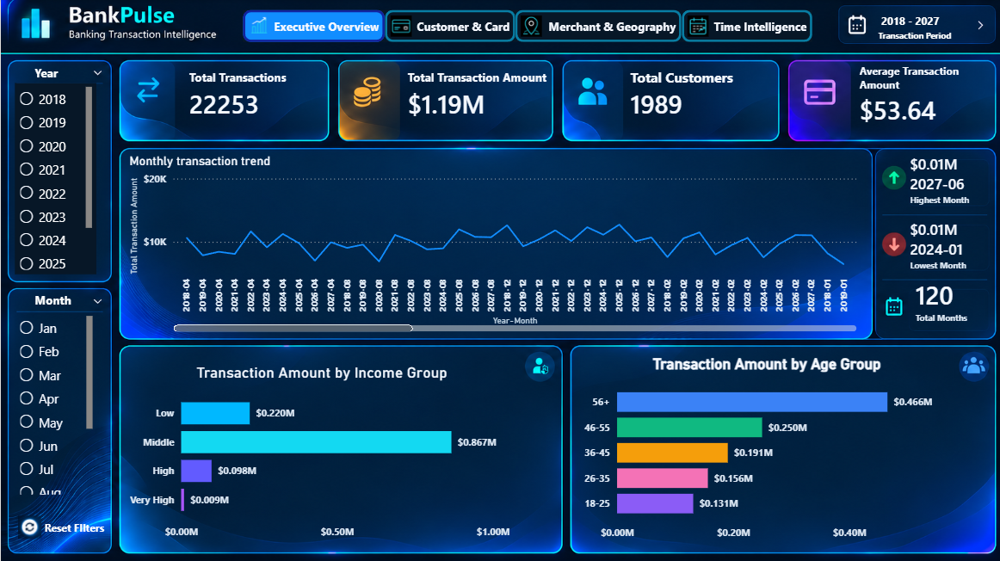

# BankPulse — Banking Transaction Intelligence Dashboard

<p align="center">
  <strong>An Interactive Power BI Project for Transaction Analytics, Customer Segmentation, Merchant Performance, and Time Intelligence</strong>
</p>

<p align="center">
  
  
  
  
</p>

---

## Project Overview

**BankPulse** is an interactive banking transaction analytics dashboard developed using Microsoft Power BI. It transforms transaction-level data into an analytical report for exploring transaction volume, transaction amounts, customer segments, card usage, merchant categories, geographical attributes, and time-based patterns.

The dashboard combines key performance indicators (KPIs), interactive filters, visual comparisons, time intelligence, and transaction-level exploration in a consistent five-page reporting experience.

The project demonstrates practical skills in business intelligence, data modelling, DAX, data visualisation, financial analytics, and interactive dashboard development.

> **Data disclosure:** BankPulse uses synthetic practice data for educational and portfolio demonstration purposes. The dashboard does not represent actual banking transactions or verified customer behaviour.

## Dashboard Preview

### 1. Executive Overview



The Executive Overview summarises overall transaction activity using KPI cards, a monthly transaction trend, and transaction amount comparisons across income and age groups.

### 2. Customer & Card


This page explores card brands, card types, customer demographics, payment channels, top customers, top cards, and transaction amounts by gender.

### 3. Merchant & Geography


This page analyses merchant categories, merchant transaction amounts, transaction counts, chip usage, merchant rankings, and monthly merchant transaction trends.

### 4. Time & Intelligence


This page examines monthly activity, weekday and hourly patterns, time-of-day transaction amounts, peak hours, monthly growth, and transaction amount bands.

### 5. Transaction Data Explorer


The Transaction Data Explorer provides a transaction-level view with filters for year, month, merchant city, merchant state, transaction amount, and chip usage.

*Note: Screenshot paths must match the actual filenames committed to the repository.*

---

## Project Objectives

- Monitor transaction volume and total transaction value.
- Calculate average transaction amount and unique customer counts.
- Analyse customer demographics and card usage.
- Compare transaction activity across merchants and merchant categories.
- Explore transaction distributions by location and payment method.
- Identify patterns across months, weekdays, hours, and time-of-day segments.
- Provide interactive filtering from high-level metrics to individual transaction records.
- Present analytical results through a consistent, professional Power BI interface.

## Tools and Technologies

| Technology | Purpose |
|---|---|
| Microsoft Power BI Desktop | Dashboard development and interactive reporting |
| Microsoft Excel | Dataset storage and source-data handling |
| Power Query | Data import and transformation, where used |
| DAX | Measures, calculations, and time intelligence |
| Data Modelling | Relationships between transaction, date, customer, card, and merchant-category tables |
| Git and GitHub | Version control and project documentation |

## Dashboard Pages

### Executive Overview

The landing page provides a high-level summary of transaction activity.

**Key Performance Indicators**
- Total Transactions
- Total Transaction Amount
- Total Customers
- Average Transaction Amount

**Visualisations**
- Monthly Transaction Trend
- Transaction Amount by Income Group
- Transaction Amount by Age Group

**Interactive controls**
- Year slicer
- Month slicer
- Reset Filters control
- Report navigation

**Purpose:** To understand the overall transaction volume and value and compare activity across customer segments.

### Customer & Card

This page focuses on customer segmentation and card-related transaction patterns.

**Key metrics shown**
- Total Card Brands
- Total Merchant Categories
- Total States Covered
- Total Card Types

**Visualisations**
- Transaction Amount by Card Brand
- Transaction Count by Card Brand
- Transactions by Card Type
- Customers by Income Group
- Customers by Age Group
- Transactions by Payment Channel
- Top 5 Customers by Transaction Amount
- Top 5 Cards by Transaction Amount
- Total Transaction Amount by Gender

**Filters**
- Card Brand
- Card Type
- Gender
- Income Group

**Purpose:** To compare transaction activity across card products, customer segments, and payment channels.

### Merchant & Geography

This page explores merchant-level and category-level transaction performance.

**Key metrics shown**
- Unique Merchants
- Total Merchant Categories
- Total Transactions
- Average Transaction Amount

**Visualisations**
- Top 5 Merchant Categories by Transaction Amount
- Transaction Count by Merchant Category
- Total Transactions by Chip Usage
- Top 5 Merchants by Transaction Amount
- Average Transaction Amount by Merchant Category
- Monthly Merchant Transaction Amount Trend
- Merchant Category by Chip Usage — Transaction Amount

**Filters**
- Merchant Category
- Merchant ID
- Chip Usage
- Year

**Purpose:** To identify high-activity merchant categories, compare merchant transaction values, and explore chip usage across categories.

### Time & Intelligence

This page analyses transaction behaviour over time.

**Key metrics shown**
- Total Transactions
- Total Transaction Amount
- Average Transaction Amount
- Total Customers
- Unique Merchants

**Visualisations**
- Monthly Transactions & Amount Trend
- Transactions by Day of Week
- Transactions by Hour of Day
- Total Transaction Amount by Time of Day
- Top 5 Merchant Categories by Amount
- Top 5 Merchant Categories by Transaction Count
- Peak Transaction Hours
- Monthly Growth (%)
- Total Transactions by Amount Band

**Filters**
- Year
- Month
- Weekday
- Time of Day
- Merchant Category

**Purpose:** To examine changes in transaction volume and amount across time periods and identify peak activity windows.

### Transaction Data Explorer

This page provides a detailed view of transaction records.

**Summary cards**
- Total Transactions
- Total Transaction Amount
- Date Range

**Filters**
- Year
- Month
- Merchant City
- Merchant State
- Transaction Amount
- Chip Usage

**Transaction fields displayed**
- Transaction ID
- Transaction Date and Time
- Transaction Amount
- Client ID
- Card ID
- Chip Usage
- Merchant ID
- Merchant State
- Merchant City
- ZIP Code
- Merchant Category Code (MCC)
- Error Status

**Purpose:** To inspect individual records and investigate transactions using the available filters.

## Key Performance Indicators

| KPI | Description |
|---|---|
| Total Transactions | Number of transaction rows in the current filter context |
| Total Transaction Amount | Sum of transaction amounts |
| Average Transaction Amount | Average transaction amount |
| Total Customers / Unique Customers | Distinct customer identifiers |
| Unique Merchants | Distinct merchant identifiers |
| Total Card Brands | Number of distinct card brands represented |
| Total Card Types | Number of distinct card types represented |
| Total Merchant Categories | Number of merchant categories represented |

KPI values change when report filters are applied. Displayed amounts and counts describe the loaded practice dataset and should not be interpreted as real banking performance.

## Dataset

The project uses a synthetic transaction dataset covering transaction-related information, customer attributes, card attributes, merchant identifiers, merchant categories, and date information.

### Main Data Tables

| Table | Purpose |
|---|---|
| `transactions_data` | Main transaction fact table |
| `Calendar` | Date dimension for year, month, weekday, and time-based analysis |
| `users_data` | Customer attributes used for demographic and income-group analysis |
| `cards_data` | Card attributes used for card-brand and card-type analysis |
| `mcc_codes` | Merchant category code lookup |

### Important Transaction Fields

| Field | Description |
|---|---|
| `id` | Transaction identifier |
| `date` | Transaction timestamp |
| `client_id` | Customer identifier |
| `card_id` | Card identifier |
| `amount` | Transaction amount |
| `use_chip` | Chip/payment indicator |
| `merchant_id` | Merchant identifier |
| `merchant_city` | Merchant city |
| `merchant_state` | Merchant state |
| `zip` | ZIP/postal code field |
| `mcc` | Merchant category code |
| `errors` | Source transaction error text, where available |

### Data Modelling

The report uses a Calendar table for date-based reporting. The intended model connects `Calendar[Date]` to a date-only transaction field using an active one-to-many relationship. The original transaction timestamp is retained for hour-of-day analysis.

The `mcc_codes` table provides merchant-category information for category-level analysis. The customer and card tables provide attributes used by the demographic and card visuals.

The final Power BI model should be consulted for the exact relationships and column definitions.

## DAX Measures

The following core measures are used as the basis for the dashboard KPIs.

### Total Transactions

```DAX
Total Transactions =
COUNTROWS('transactions_data')
```

### Total Transaction Amount

```DAX
Total Transaction Amount =
SUM('transactions_data'[amount])
```

### Average Transaction Amount

```DAX
Average Transaction Amount =
AVERAGE('transactions_data'[amount])
```

### Unique Customers

```DAX
Unique Customers =
DISTINCTCOUNT('transactions_data'[client_id])
```

### Unique Merchants

```DAX
Unique Merchants =
DISTINCTCOUNT('transactions_data'[merchant_id])
```

### Monthly Growth

The following reference logic compares the current month's transaction count with the previous month's transaction count.

```DAX
Previous Month Transactions =
CALCULATE(
    [Total Transactions],
    DATEADD('Calendar'[Date], -1, MONTH)
)
```

```DAX
Monthly Growth % =
DIVIDE(
    [Total Transactions] - [Previous Month Transactions],
    [Previous Month Transactions],
    BLANK()
)
```

Format `Monthly Growth %` as a percentage in Power BI. The date relationship and chronological Year-Month sorting must be correct for reliable time-intelligence results.

*These DAX examples document the core calculation approach. The PBIX model is the source of truth for the measures currently implemented in the report.*

## Analytical Questions

BankPulse supports exploration of questions such as:

1. How does transaction volume and value change over time?
2. Which income and age groups account for the largest transaction amounts?
3. How do transaction amounts differ across card brands and card types?
4. Which merchant categories have the highest transaction totals or counts?
5. Which merchants account for the largest transaction amounts?
6. How does transaction activity vary by weekday and hour?
7. What time of day has the highest transaction amount?
8. How does chip usage vary across transactions and merchant categories?
9. How do transaction counts and amounts change when different slicers are applied?
10. Which individual transaction records match selected filter criteria?

These are analytical questions the dashboard enables. Actual findings should be drawn from the report's current results.

## Design System

BankPulse uses a dark, high-contrast interface designed for consistency across all five pages.

| Design Element | Colour | Purpose |
|---|---|---|
| Background | `#061A33` | Deep navy canvas |
| Primary accent | `#13C8F5` | Cyan borders, highlights, and active states |
| Secondary accent | `#E94BEF` | Pink visual differentiation |
| Secondary accent | `#A020F0` | Purple visual differentiation |
| Text | `#FFFFFF` | Titles, labels, and KPI values |

The report uses consistent navigation buttons, KPI cards, chart containers, slicers, and reset controls to create a unified experience.

## Repository Structure

```text
BankPulse/
│
├── Banking_Analytics.pbix
├── README.md
├── BankPulse_Project_Documentation_Final.pdf
│
└── Screenshots/
    ├── executive-overview.png
    ├── customer-card.png
    ├── merchant-geography.png
    ├── time-intelligence.png
    └── transaction-data-explorer.png
```

*Adjust filenames in this example to match the actual files in your GitHub repository. Add your source dataset only if you intend to distribute it and have permission to share it.*

## How to Use the Project

1. Clone or download the repository.
2. Open `Banking_Analytics.pbix` using Microsoft Power BI Desktop.
3. If Power BI requests the source data location, update the data-source path to the local dataset file.
4. Refresh the data if required.
5. Navigate through the five report pages.
6. Use the slicers and visual interactions to explore transaction records and aggregated metrics.

## Skills Demonstrated

- Power BI dashboard development
- Data modelling and relationship design
- DAX measures and KPI development
- Time-intelligence calculations
- Interactive reporting and cross-filtering
- Customer and card segmentation
- Merchant and transaction analysis
- Financial data visualisation
- Data exploration and analytical communication
- Git and GitHub documentation

## Future Enhancements

Potential extensions to the project include:

- A dedicated global transaction search and advanced table filtering, if not already implemented
- Verified pagination and page-size controls in the Transaction Data Explorer
- Drill-through from summary visuals to transaction details
- Enhanced tooltip pages
- Additional data-quality checks and validation
- Further time-based comparisons and anomaly analysis
- Automated data refresh where supported
- Carefully validated scenario analysis

These are potential enhancements and should not be considered implemented until they are available in the report.

## Disclaimer

BankPulse is an independent educational portfolio project. It is not affiliated with, endorsed by, or developed for any bank or financial institution.

The dataset is synthetic and should not be interpreted as evidence of real customer behaviour, fraud rates, or banking performance. The dashboard is intended to demonstrate business intelligence and data analytics techniques, not to support actual financial or banking decisions.

---

<p align="center">
  <strong>BankPulse — Turning Transaction Data into Clearer Insights</strong>
</p>
